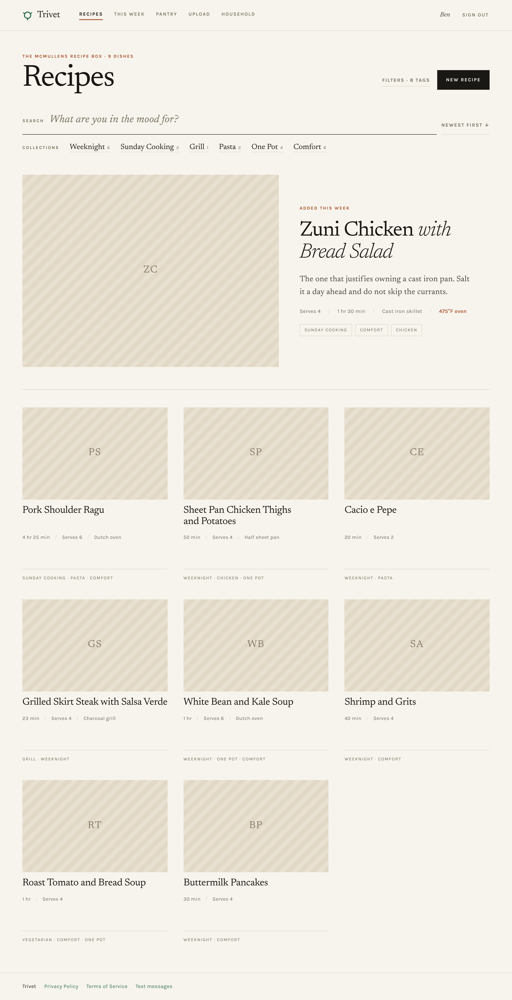
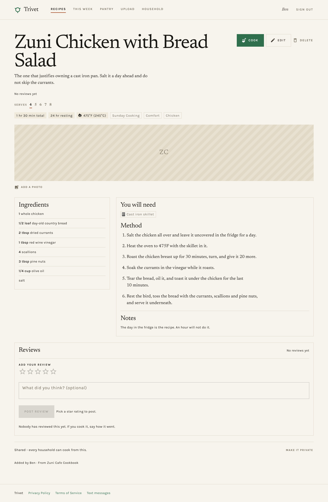
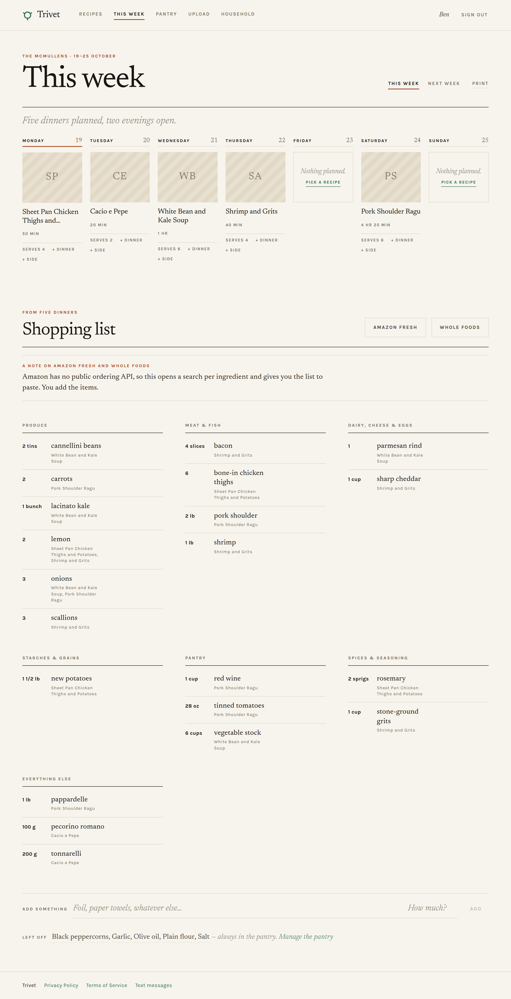
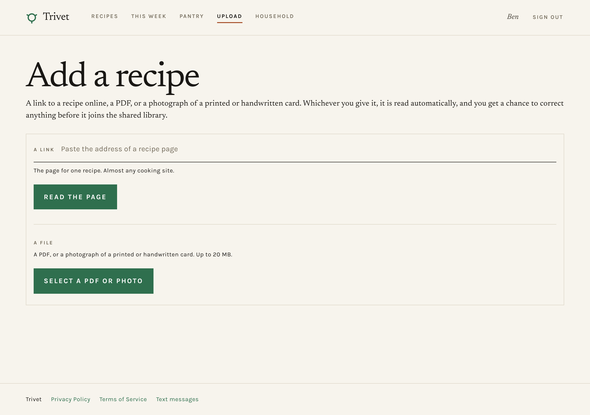

# Trivet

Recipe box, weekly meal planner and grocery list for one household.
Add a recipe from a link, a PDF, a photograph of a printed or handwritten
card, pasted text, or screenshots of a caption shared from your phone, plan a
dinner for each night from your library, and take the resulting shopping list
to the shop.

Live at [trivetbox.com](https://trivetbox.com), and on iPhone in a family beta
(TestFlight, build 5). Releases are tagged: `v2.0.0` is the current one, with
its notes on GitHub, and each TestFlight build gets an `app-<version>-<build>`
tag (`app-1.0-5`) so a tester's report can be traced to the code they ran.
The [case study](docs/case-study.pdf) covers why it works the way it does: the
problem, the decisions, what was cut, and what comes next.

## Demo video

https://github.com/user-attachments/assets/f4008d4c-4334-4b36-83d7-cc69ad15a5a2

## What it looks like

The library, newest dish given the hero and the rest in a grid. Collections are
a curated way in; everything else lives behind Filters.



A recipe, with everything the card printed: timings, resting, oven temperature,
equipment, and what the household thought of it.



The week, and the list it produces. Ingredients roll up across the meals
planned, grouped by aisle, with the dish each line came from underneath it.



Add a recipe from a link to one online, a PDF, or a photograph of a card.



Screenshots are of a seeded demo library, so no dish photos are attached - the
striped placeholders are what the app draws when a recipe has none. They are
taken from `npm run seed:demo`, so retaking them is a command rather than an
afternoon:

```
npm run browse:seed   # once, with the app running
npm run seed:demo
npm run browse -- /recipes --shot=docs/screenshots/recipes.png
npm run browse -- /recipes/zuni-chicken-with-bread-salad-03a14891 --shot=docs/screenshots/recipe.png
npm run browse -- /plan --shot=docs/screenshots/planner.png
npm run browse -- /upload --shot=docs/screenshots/upload.png
npm run browse -- /pantry --shot=docs/screenshots/pantry.png
npm run browse -- /household --shot=docs/screenshots/household.png
```

The recipe's address is stable across reseeds: `seed:demo` derives each
`publicId` from a hash of the title rather than at random, so the hero keeps
the same URL and this command does not need editing every time.

## What works

- **Invite-only accounts.** Signup requires a code minted by an existing user.
  A recipe belongs to the household that added it and is private to them until
  they share it; a shared one appears in every household's library.
- **Invites by text or email.** A new code comes with **Text it**, which opens
  your own Messages with the invite written in, and **Copy link** for anywhere
  else. Give their email address and Trivet sends the invitation itself, from
  your name. Either way the link is `/sign-up?code=...`, so the person you
  invite taps once and lands on a form with the code already filled in.
- **Recipe library.** Create, edit and delete recipes with ingredients, method,
  servings, timings, oven temperature, resting time, yield, equipment and tags -
  everything a recipe card prints, so you never have to reopen the original.
  Calories, protein, carbs and fat per serving are transcribed when the source
  states them; when it states none, the importer estimates them from the
  ingredients and the recipe says "Per serving, estimated". Changing any figure
  drops the label. Each recipe also records its course (dinner, side,
  breakfast, dessert, snack, other), with a page to sort the library by it.
- **Search.** Full-text plus substring matching across titles, descriptions,
  method text, ingredients and tags, with tag filters. Search state lives in the
  URL, so a filtered view is linkable.
- **Adding a recipe: a link, a PDF, a photograph or some text.** Paste the
  address of a recipe page, upload a card (several photos read as one recipe),
  or paste a recipe copied from a message or a note, and Claude reads it into
  fields, landing on a review screen before anything is saved. A site that only answers a real
  browser is named as such, with a way round it: print the page to a PDF and
  bring that in instead. A PDF also gives up its dish photo, which is pulled out and attached.
  Photographs are accepted as JPEG, PNG, GIF or WebP - the four formats the
  model itself accepts - so a picture of a card stuck to the fridge, or of a
  page in a book, works as well as an exported file. HEIC, which is what an
  iPhone stores by default, is converted in the browser before it is sent.
- **Reviews.** A star rating and, optionally, what you thought - one review per
  person per recipe, so the average says how many people liked a dish rather
  than how often its keenest fan said so. The average shows on the library
  cards, the planner tiles and the recipe itself.
- **Duplicate detection.** A re-uploaded card - PDF or photograph - is
  recognised by its bytes and refused before the model is called; a
  familiar-looking title warns rather than blocks.
- **Weekly planner.** A dinner a night, picked from tiles showing the dish
  photo, title and its rating. An evening can take up to three dinners and a
  side: the first is the photo, the rest are a line each under it, and every
  one of them scales into the shopping list the same way. The planner shows
  this week and next, and can suggest dinners for the open evenings from the
  library: what has not been planned for a while, what fits a weeknight
  (quick Monday to Thursday), and the household's regulars, with stars only as
  a tiebreaker.
- **A cooking view.** `/recipes/<id>/cook` is the recipe as something you are
  in the middle of: one step at a time in large type, ingredients a tap away
  without losing your place, and the screen held awake so a propped-up phone
  does not sleep between steps. Where you got to survives a reload. Finishing
  counts the dish as made, and a recipe shows when it was last cooked.
- **Pantry.** The staples you always have in, managed as a list of their own.
  Nothing in it ever reaches a shopping list, however many recipes call for it.
- **Grocery list.** Ingredients roll up across the week's meals, scaled to the
  servings planned and merged where names and units agree. Pantry staples and
  anything ticked off for the week drop out before the merge.
- **Anything else you need.** Kitchen roll, dish soap, a birthday cake - things
  no recipe asks for go on the week's list by hand, sorted into the aisle
  they'll be found in, and travel with it to the shop hand-off and the text.
- **Shopping hand-off.** Text the week's list (below), or copy it. An Instacart
  provider that builds a real cart is written and tested but hidden until a
  production key exists, which Instacart is not issuing - see below. The Amazon
  Fresh and Whole Foods buttons were removed: with no ordering API they could
  only open a search per ingredient.
- **An activity overview.** `/admin` lists the households, how much each is
  using the planner, and how many cards they have uploaded. Counts and dates
  only. It also holds the report queue (below). Reachable by the addresses in
  `ADMIN_EMAILS` and answering 404 to everybody else.
- **Reporting and hiding shared content.** On another household's shared
  recipe, and on a review from one, **Report** (a reason and a note, emailed to
  the admins and queued on `/admin`, where a recipe can be taken out of the
  shared library or a review deleted) and **Hide** that household (its shared
  recipes and reviews leave your library, search, averages and recipe pages;
  undone from the Household page). Apple's guideline 1.2; the rules are in the
  terms.
- **Deleting your account,** from the Household page, confirmed by typing your
  email. If others stay, the household keeps everything you added; the last
  person out takes the household, its shared recipes and its stored files.
  Apple's guideline 5.1.1(v).
- **AI assistants (MCP).** Connect Claude, or another assistant that speaks
  the Model Context Protocol, and ask it about your recipes, week, list and
  pantry in plain words, and, if allowed, plan dinners and add to the list.
  See
  [AI assistants](#ai-assistants-mcp) below.
- **Loading.** Each main page shows its outline while it loads - its heading,
  then striped placeholders laid out as the page lays them out - so nothing
  jumps when it arrives. Designed in
  [`design_handoff_trivet_loading/`](design_handoff_trivet_loading/).
- **Texting the list.** Everyone in the household who has agreed to be texted
  gets the week's shopping as an SMS, split into readable parts. Giving a number
  is optional, and a number alone sends nothing - only those who ticked the box
  are texted. Live: registered with the carriers and delivering.

## iPhone app

A thin native app in [`ios/`](ios/) wraps trivetbox.com in a SwiftUI web view:
a home-screen icon, sign-in that persists, the camera for recipe cards, and
links to other sites opened in Safari. Every feature still lives on the website,
so a change ships to the app the moment it ships to the web. It is in a family
beta through TestFlight (build 5). [`ios/README.md`](ios/README.md) covers
building it, sending a build to TestFlight, and its known gaps.

What is native, because the web cannot do it:

- **Share to Trivet.** A share extension puts Trivet in the iPhone share sheet
  for a recipe page from Safari or Chrome, a recipe in Notes or Messages, a
  photo of a card, a PDF, or screenshots of a TikTok or Instagram caption -
  neither app lets a caption be copied, so screenshots are the way in. The
  screenshots are read on the phone with Vision's text recognition, and only
  the words travel; the sheet shows what it read before you leave. Trivet then
  opens on the Add a recipe page with the share already being read.
  [`SHARE-SHEET-PLAN.md`](SHARE-SHEET-PLAN.md),
  [`design_handoff_trivet_share/`](design_handoff_trivet_share/).
- **Launch and opening.** A launch screen in Trivet's colours with the mark,
  then the same mark with its centre simmering until the first page fades in,
  instead of a white screen. After eight seconds it says the connection is
  slow; with no connection at all, a plain screen with Try again.

A React Native rebuild was considered and set aside: it meant rewriting every
screen for little the web didn't already do. The beta decides what, if anything,
goes native.

### What's next

- **Offline shopping list.** A saved copy of the list that opens in a shop with
  no signal, with items crossed off on the phone and sent to the household's
  list only when someone chooses to, back in range. Designed in
  [`design_handoff_trivet_offline/`](design_handoff_trivet_offline/) and planned
  in [`OFFLINE-BROWSING-PLAN.md`](OFFLINE-BROWSING-PLAN.md); not built yet.
- **How we eat, by person.** Each person at the table (account or not) has a
  diet, each recipe records the strictest diet it fits, and the library follows
  the person signed in. [`DIET-PLAN.md`](DIET-PLAN.md); not built yet.
- **Cook with an ingredient.** Start from one ingredient and get dishes from
  your library, then from a short curated list of recipe sites.
  [`COOK-WITH-PLAN.md`](COOK-WITH-PLAN.md); not built yet.
- **Channels.** Curated collections owned by Trivet or a local food partner,
  which households can follow. Partners are free; Trivet has no ads.
  [`CHANNELS-PLAN.md`](CHANNELS-PLAN.md); exploratory.
- **The public App Store,** as a free download with a one-time household
  unlock, no subscription. Not planned in detail yet.

## AI assistants (MCP)

Trivet is an MCP server, so a person can connect their own AI assistant to
their Trivet once and then ask it things like _"what can I make with the
grouper I bought?"_, _"what's on the plan this week?"_ or _"what's on the list
that we don't already have?"_. The thinking happens in the person's assistant,
on their own subscription; Trivet only answers with data. The plan is
[`MCP-PLAN.md`](MCP-PLAN.md).

### Connecting

In the Claude app or on claude.ai: **Settings → Connectors → Add custom
connector**, paste `https://trivetbox.com/api/mcp`, then sign in to Trivet and
approve on the consent screen, ticking **Also let it plan** if it may change the
plan, pantry and list. Other assistants that support remote MCP servers
with OAuth take the same address, including tools that sign in through a
callback on your own computer, such as Claude Code
(`claude mcp add --transport http trivet https://trivetbox.com/api/mcp`) or
Cursor. Nothing to install, and nothing in the iPhone
app: the assistant talks to the website.

To disconnect: **Household → Connected assistants → Disconnect.** The assistant
is refused on its very next call.

### What an assistant can do

Look, behind the `recipes:read` scope:

| Tool                 | Answers with                                                                                                                       |
| -------------------- | ---------------------------------------------------------------------------------------------------------------------------------- |
| `search_recipes`     | Recipes matching words, an ingredient, a tag or a course, 20 at a time (up to 50), with the total and how to page through the rest |
| `get_recipe`         | One recipe in full: ingredients, method, timings, oven, equipment, nutrition per serving, notes, source                            |
| `get_week`           | A week's plan, Monday to Sunday, each meal with its slot, servings and recipe                                                      |
| `get_shopping_list`  | The week's list as Trivet builds it: merged and scaled, minus pantry staples and ticked items, plus extras                         |
| `get_pantry`         | The household's staples                                                                                                            |
| `suggest_dinners`    | Trivet's own pick for each open evening of a week, with why; plans nothing                                                         |
| `import_recipe_link` | A trivetbox.com link that opens Add a recipe already reading a web page; saves nothing                                             |

Plan, behind `plan:write`, only if the person ticks **Also let it plan** on the
consent screen (it starts unticked):

| Tool              | Does                                                                                             |
| ----------------- | ------------------------------------------------------------------------------------------------ |
| `plan_dinner`     | Puts a recipe on a day (up to three mains and a side), or clears the slot; says what it replaced |
| `add_pantry_item` | Adds a staple                                                                                    |
| `add_to_list`     | Adds something no recipe asks for to a week's list                                               |

Every tool answers for the signed-in person's household through the same code
as the website: their own recipes and the shared library, minus hidden
households, and never another household's private recipe. Planning uses the
planner's own logic (`src/lib/plan-mutations.ts`), so servings come from the
household and only recipes it can see can be planned. An assistant that may
only look is never shown the planning tools at all.

Each change is recorded with the assistant that made it, and the latest shows
under that assistant on the Household page ("Latest: Planned Cacio e Pepe for
dinner on 2026-11-20"). Everything an assistant plans shows in Trivet to undo.
An assistant can never delete a recipe, change the household, save a recipe
without a person's review, or text the list.

Each person's assistants share an allowance of 1,000 requests a day
(`MCP_DAILY_LIMIT`), there to stop a runaway loop rather than to ration use.

The server tells the assistant to treat recipe text as data, not instructions,
since shared recipes are other people's words.

### Using it

Once connected, ask in an ordinary chat, with Trivet switched on for that chat
(in Claude, the connectors menu under **+**). For example:

- _What can I make with the grouper I bought?_
- _What's on this week, and what do I still need to buy?_
- _Suggest dinners for next week, nothing over 45 minutes on weeknights, and
  plan the ones I like._
- _Add dish soap and two litres of milk to the list._

An assistant connected before planning existed can only look. To let it plan,
Disconnect it on the Household page, connect it again, and tick **Also let it
plan**.

### How it works

- **`/api/mcp`:** the MCP endpoint, Streamable HTTP and stateless. Each
  request builds a server for the person the token belongs to
  ([`src/lib/mcp/`](src/lib/mcp/)).
- **Sign-in:** Better Auth's `mcp()` plugin makes Trivet the OAuth 2.1
  provider, with `jwt()` signing the tokens. Assistants register by Client ID
  Metadata Document (`@better-auth/cimd`) or by dynamic registration.
  Registering grants nothing: every grant needs a person to sign in and
  approve it on `/consent`.
- **Discovery:** `/.well-known/oauth-protected-resource`,
  `/.well-known/oauth-authorization-server` and
  `/.well-known/openid-configuration`. A call without a token gets a 401 that
  points the assistant at them.
- **Checks on every call:** the token's signature, expiry, scope, and that it
  was issued for `/api/mcp`; then that the person's consent is still on file
  and they still belong to a household. That last check is what makes
  Disconnect immediate rather than waiting for the token to expire.
- **Address:** tokens are bound to `BETTER_AUTH_URL`, so a domain change
  means everyone reconnects ([`DEPLOYING.md`](DEPLOYING.md)).

### Trying it locally

With `npm run dev` on port 3000 and a local account (`npm run browse:seed`,
then `npm run seed:demo` for a library to ask about), point the
[MCP Inspector](https://github.com/modelcontextprotocol/inspector) at
`http://localhost:3000/api/mcp`:

```bash
npx @modelcontextprotocol/inspector
```

It runs the same sign-in and consent as Claude does, then lists the tools to
call by hand. `test/mcp.test.ts` covers the household scoping and Disconnect.

## Stack

| Concern   | Choice                                                       |
| --------- | ------------------------------------------------------------ |
| Framework | Next.js 16 (App Router) + React 19                           |
| Language  | TypeScript                                                   |
| UI        | Material UI 9 (emotion), light + dark                        |
| Database  | Postgres via Prisma 7                                        |
| Auth      | Better Auth (email + password, invite-gated)                 |
| MCP       | MCP TypeScript SDK; Better Auth as the assistants' OAuth     |
| Storage   | Vercel Blob, with a local-disk driver for dev                |
| AI        | Claude: reading cards, pages and text; estimating nutrition  |
| iOS       | SwiftUI web view + share extension (Vision text recognition) |
| Tests     | Vitest, against a real Postgres                              |

## Getting started

```bash
npm install            # postinstall runs `prisma generate`
cp .env.example .env   # then fill in the values below
npm run db:migrate     # creates the schema
npm run dev            # http://localhost:3000
```

You need a Postgres instance. Anything works locally; production is Neon.

### Environment

| Variable                | Needed for            | Notes                                              |
| ----------------------- | --------------------- | -------------------------------------------------- |
| `DATABASE_URL`          | everything            | Postgres connection string                         |
| `BETTER_AUTH_SECRET`    | sessions              | `openssl rand -base64 32`                          |
| `BETTER_AUTH_URL`       | sessions              | The app's own origin                               |
| `ANTHROPIC_API_KEY`     | reading a card        | Without it, upload returns a clear 422             |
| `UPLOAD_DAILY_LIMIT`    | capping the bill      | Cards per person per day. Unset means 30           |
| `INSTACART_API_KEY`     | sending a cart        | Without it, the planner says so and stays usable   |
| `INSTACART_API_BASE`    | sending a cart        | Dev server by default; switch for production       |
| `BLOB_READ_WRITE_TOKEN` | uploads in production | Unset locally: files go to `public/uploads/`       |
| `TWILIO_ACCOUNT_SID`    | texting the list      | All three are needed; any missing hides the button |
| `TWILIO_AUTH_TOKEN`     | texting the list      | The account's auth token, not an API key secret    |
| `TWILIO_FROM_NUMBER`    | texting the list      | E.164, e.g. `+15085551212`                         |

Missing optional keys degrade gracefully — the rest of the app keeps working
and the affected feature explains what is missing.

### Creating the first account

Signup is invite-only and there is no bootstrap UI yet, so the first user is
made by hand:

```sql
INSERT INTO "user"(id, name, email, "emailVerified", "createdAt", "updatedAt")
VALUES ('bootstrap', 'Your Name', 'you@example.com', true, now(), now());

INSERT INTO invite(id, code, "expiresAt", "createdAt", "createdById")
VALUES ('bootstrap-invite', 'PICKSOMETHINGRANDOM', now() + interval '7 days', now(), 'bootstrap');
```

Then visit `/sign-up?code=PICKSOMETHINGRANDOM`. (Delete the placeholder row
afterwards if you like — the invite survives on its own.)

## Deploying

See [DEPLOYING.md](./DEPLOYING.md) for the full walkthrough — Neon, Vercel Blob,
environment variables, and creating the first account.

Two things that bite if skipped: migrations need Neon's **direct** connection
string (`DIRECT_DATABASE_URL`), not the pooled one, and without a Blob store
uploads land in `./public/uploads`, which serverless hosting wipes on every
deploy.

`GET /api/health` reports whether a deploy reached its database and whether the
schema is present.

## Scripts

| Script                   | Does                                                                      |
| ------------------------ | ------------------------------------------------------------------------- |
| `npm run dev`            | Dev server                                                                |
| `npm run build`          | Production build                                                          |
| `npm test`               | Vitest once (**truncates the dev database**)                              |
| `npm run lint`           | ESLint                                                                    |
| `npm run typecheck`      | Route types + `tsc --noEmit`                                              |
| `npm run format`         | Prettier                                                                  |
| `npm run db:migrate`     | Create and apply a migration                                              |
| `npm run db:deploy`      | Apply migrations (production)                                             |
| `npm run db:studio`      | Prisma Studio                                                             |
| `npm run library:export` | Export the shared library for a rewrite (`.library/`, never committed)    |
| `npm run library:apply`  | Apply a reviewed rewrite of the shared library (dry run unless `--write`) |

The integration tests share one database and clean up after themselves, which
means running them against a database you care about will empty it.

## Notes and limitations

**Texting works, and getting there was most of the work.** The sender itself is
one form-encoded POST. Everything around it exists because US carriers will not
carry application-sent SMS to ordinary numbers until the sender is registered
under A2P 10DLC: a Brand, then a Campaign describing what the messages are and
how people agreed to receive them.

Unregistered traffic is not bounced, it is silently dropped — the API accepts
the message and the handset never rings, which is the worst failure shape there
is, and it cost a day before the Twilio console's message logs made it visible.
If this ever stops working, start there rather than in the code: `30034` means
the number is not registered against an approved campaign, `30007` means a
carrier filtered it, `21610` means that person replied STOP.

Two rejections were worth writing down, because neither is about the code:

- A privacy policy can be public, complete and correct and still fail vetting
  for its wording. "Never shared with third parties or affiliates" was refused;
  "do not share, sell, or provide" passed. Vetting is pattern-matching, so
  `src/lib/legal.ts` matches the pattern rather than reading better than it.
- Naming your messaging provider without naming the relationship reads as a
  disclosure of data sharing and contradicts the promise above it. "Twilio, our
  messaging service provider, acting only to transmit messages on our behalf"
  is doing real work in that sentence.

**The app is called Trivet; the text messages still say McMullen Meal Magic.**
That is not an oversight. `BRAND` in `src/lib/legal.ts` is the name on the
approved A2P campaign, it appears in every message body, and carrier vetting
compares the two. Renaming it before the campaign is re-registered would not
produce a branding inconsistency — it would produce silently undelivered
messages, which is the same failure as being unregistered. The order is:
register the new name, wait for approval, then change that one constant and the
two tests that pin it. Those tests failing is the tripwire, and it is deliberate.

The registration is a sole-proprietor Brand, which carries low daily throughput
caps. A household and a weekly list is nowhere near them.

The consent machinery is what the registration was built on, and it is the part
that reads as over-engineering until a carrier asks to see it:

- A number is only ever entered by its owner. `saveOwnPhone` writes the
  caller's own row and nothing else — a digit wrong sends the week's shopping
  to a stranger.
- A number is not consent. `smsConsentAt` and `smsConsentSource` are stored
  separately, because being reachable and having agreed are two different
  facts, and a carrier asking to see the opt-in is asking about the second.
  Agreeing to texts is never a condition of having an account; carrier rules do
  not allow it. (A phone was briefly required to join and was made optional
  again: it bought no way of reaching anybody, since only members who tick the
  box can be texted, and gave a stranger signing up nothing to say yes to.)
- Invites are texted from the inviter's own phone, never from this app's
  number. The campaign is registered for one purpose - the shopping list, to
  members who agreed - and an invitee has agreed to nothing. Sending from the
  app's number would break the registration that the shopping lists depend on.
  From the inviter's phone it is one person texting another, which needs
  neither, and it arrives from someone they know.
- The checkbox is never pre-ticked, and there is no prop that would let it be.
- `/privacy`, `/terms` and `/sms` are public, deliberately outside the login,
  because a policy nobody can read without an account is a policy a reviewer
  will reject. The wording lives in `src/lib/legal.ts` so the box, the pages
  and the campaign submission cannot drift apart.
- A reply of STOP is handled by Twilio, which never tells the application. The
  only notice is a `21610` on the next send, and that clears the person's
  consent while keeping their number — so re-agreeing is a tick rather than
  typing it in again.

**The app cannot tell you a text was delivered.** Twilio answers `201` when it
accepts a message for delivery, which is not the same as a carrier handing it
to a handset, and that response is all the sender sees. So a send that is
filtered downstream is reported as a success. Real delivery state needs a
status-callback webhook, which does not exist yet; until it does, Twilio's
Messaging logs are the only place the truth lives.

**Reading a card is metered per person, per day.** It is the only operation
here that costs money every time it runs, and `/api/upload` is reachable by
anyone with an account - a theoretical problem for one household, and somebody
else's enthusiasm arriving on your bill for thirty.

The counter is a row per person per day in Postgres rather than anything new to
run. It is claimed immediately before the model call and nowhere earlier: a
duplicate file or a damaged one is refused for free and should not spend an
allowance on a call that never happens. A refused attempt still increments, so
hammering the endpoint cannot walk the count back into range.

The ceiling is not there to shape how people add recipes - a household typing
up twenty cards the evening they join should sail through it - only to stop a
runaway loop being unbounded. `UPLOAD_DAILY_LIMIT` moves it; a value that is
not a positive integer falls back to the default rather than becoming `NaN`,
which would compare false against everything and quietly switch the limit off.

**A recipe is private until it is shared, and sharing means sharing with
everybody.** Not with a named household: there are a handful of them, all
invited by somebody already here, and a targeting table would be machinery for
a permission nobody has asked for. `Recipe.isShared` can become a join table
later without the read path changing shape.

Everything that existed when the column arrived was backfilled shared. The
library had been visible to every signed-in person since it was built, and
defaulting it to private would have taken dishes away from households that had
been cooking from them for months. Only recipes added afterwards start private.

The rule lives in `src/lib/recipe-visibility.ts` and nowhere else, because "who
can see this" is exactly the kind of thing that is right in four places and
forgotten in the fifth - and the fifth is the one that shows somebody another
family's dinner. Search needs it twice, once as a Prisma filter and once as SQL,
since ranking cannot be expressed in Prisma; both live in that file so the pair
is read and changed together.

Three things follow from visibility that are easy to miss:

- **Ratings follow it exactly.** One average per recipe, over everybody who can
  open it. A shared recipe pools verdicts across households, which is the point;
  a private one is rated only by the family that has it. Writing a review checks
  visibility rather than existence, or a guessed id would move an average on a
  dish somebody cannot read - and the response would tell them it is there.
- **Tag counts are per household.** The vocabulary is shared, the numbers are
  not: a count over the whole table offers a filter that returns nothing, and
  the number itself says how many recipes sit behind a closed door.
- **Duplicate detection is per household.** `sourceFileSha256` used to be
  globally unique, so a widely printed card that two families both own was
  called a duplicate - and the refusal told the second family that a recipe they
  could not see existed. The constraint is now on (household, hash).

**Planning a shared recipe takes a reference, not a copy.** The plan stores the
id, so the owner's later edits reach a meal another household has already
planned. Un-sharing is deliberately not retroactive: a week already planned
keeps the dish and still gets its ingredients on the shopping list. Pulling
dinner out of somebody's Thursday, days later, because another family changed
its mind is worse than the recipe staying readable to the few who had committed
to cooking it.

**An evening is a fixed list of slots, not a count.** Three dinners and a side
are four enum values on `MealSlot`, which keeps the
`(householdId, date, slot)` unique key that every planner query and the side
upsert rely on. The alternative — a `position` column and as many rows as you
like — means changing that key, and the only thing it buys is a fourth dinner
that nobody has asked for. As values, a fourth is two lines of SQL and no
application change at all: `ALTER TYPE ... ADD VALUE` rewrites no table.

Sides hang off the day rather than off a dinner, which is the decision that
made the slots work. One set of sides for the evening, whichever mains are on
it; sides per dinner is what would have forced the position column. The side
suggestion reads the day's first dinner to have something to suggest against,
and says so where it does it.

The extra dinners are a line of text under the first one, not a second photo
tile. A day tile is about 180px on a phone, and three photo tiles stacked is a
page nobody scrolls; one dish is the one you recognise across the room and the
others are "and Lamb Tagine". All of them scale and merge into the shopping
list identically — that part never knew how many dinners a day had.

**Two kinds of rot, and only one of them is CI's.** `ci.yml` runs on every
push and answers "did this commit break anything". Nothing in it answers "did
the world move while nobody was looking" - an advisory published against a
package nobody touched, a dependency quietly three majors behind, a schema that
drifted from its migrations. Those rot on a calendar, so `health.yml` checks
them on one, every Monday.

It reports rather than fixes, and it reports into a single issue that is
rewritten each week and closed the week it comes back clean. A new issue every
Monday is a pile of stale duplicates, and an open issue reading "all clear" is
the same noise more politely - either one teaches people to skip the label that
matters.

Patches alone never open it. They arrive constantly, `npm audit` speaks up when
one of them matters, and a weekly notice nobody needs to act on is how somebody
learns to skip the notice that does. Advisories are counted twice, once over
everything and once with `--omit=dev`, because "eight advisories" and "one a
stranger could reach" are different sentences deserving different Mondays.

It also watches the two things that expire on a date rather than on a release.
Runtime support windows - Node, Postgres, Next - are looked up against
endoflife.date each week rather than written down, because a support date
copied into a repo is wrong the first time upstream moves it and nobody
re-reads a constant. A lookup that fails is reported as a failure and raises
the alarm: not knowing and being fine are different answers, and a check that
silently returns nothing every week is worse than no check because it looks
like one.

Credential ages are the opposite, and live in `lifecycle.json`, because no API
can say when somebody last rotated a token. A date nobody has recorded is
reported and never opens the issue on its own - that is a form to fill in, not
a weekly alarm - while a rotation past its own interval does.

**Instacart does not place orders.** Both of its endpoints return a URL to a
prepared page; the customer checks out on Instacart. That is the entire
integration surface — nothing after the hand-off is visible to this app.

**Amazon cannot build a cart at all.** There is no public Amazon Fresh or Whole
Foods ordering API; access is granted case by case through a business
arrangement with Amazon's Fresh team. The Amazon buttons that opened a search
per ingredient were removed in October: nobody adds a week's shopping to a
basket one search at a time.

**Instacart cannot be switched on at present.** Instacart's developer page still
says it is not accepting new applications and has no waitlist (checked again in
November 2026). A development key reaches only Instacart's test server, where a
list opens but cannot be checked out, so it is not worth setting in production.
A monthly reminder re-checks the page; once Trivet is on the public App Store,
the plan is to ask Instacart about an integration directly.

The integration is kept intact rather than deleted, but it says nothing about
itself: no boot warning, no entry in `/api/health`, and no greyed-out button on
the planner. A permanent notice about something nobody can act on is how people
learn to read past notices. The planner offers whatever `listUsableProviders()`
returns, which filters on `available` rather than naming Instacart — so setting
`INSTACART_API_KEY` is the whole of the work if applications reopen.

The integration is kept rather than removed: it is written and tested, and works
the day a production key exists: set `INSTACART_API_KEY`, set
`INSTACART_API_BASE` to `https://connect.instacart.com`, and redeploy. Until
then the planner shows no Instacart button, and texting the list is the
hand-off.

**The Instacart request shape is written from documentation, not from a live
call.** No API key was available while building it, and the docs host is
unreachable from the build environment, so the request is covered by tests
against a stubbed transport rather than a real response. Since applications are
closed there is currently no way to verify it against a real response — do that
before trusting it, whenever a key becomes obtainable.

**HEIC is converted in the browser, and the decoder is only fetched when one
turns up.** An iPhone stores photos as HEIC, and nothing downstream reads one:
not the Claude API, not the app's own validation, not most browsers' decoders.
iOS often transcodes to JPEG when a file input asks for JPEG - but only often.
Chrome on iOS, the Files app, Android, and a HEIC that reached a laptop by
AirDrop all hand over the original.

So the first twelve bytes of any picked file are sniffed, and a HEIC pulls in
`heic-to` through a dynamic import. That decoder is about three megabytes of
WebAssembly, which is why it is not in the main bundle: opening the upload page
does not fetch it, and somebody who only ever uploads JPEGs never does.

A conversion that fails hands back the original untouched rather than throwing.
The server then identifies it by its bytes and gives the clear explanation it
always did - a failure here should cost the good error message, not replace it
with a worse one.

Neither file input lists `image/heic` in its `accept`, deliberately. Naming it
makes Safari hand over the original instead of transcoding, and has been
observed to make Safari convert JPEGs _into_ HEIC. The accept list is a hint
that nudges the picker; the conversion is the actual safety net, since accept
is advisory and phone pickers routinely ignore it.

**A real HEIC has never been through this.** The environment it was built in
has no HEIC encoder, so the tests cover the sniffing, the dynamic import, the
renaming and the fallback - all against a synthetic file with a genuine HEIC
header and a body no decoder could read. The path was also driven in a browser:
the decoder chunk is fetched when a `.heic` is picked and not before, and the
failure falls through to the server's message. What is unproven is one real
photo from one real iPhone coming out the other side as a readable JPEG. Try it
before relying on it.

**Pulling the dish photo out of a PDF is JPEG-only.** Images stored as
DCTDecode streams are already complete JPEG files and can be written straight
out. Other encodings hold raw samples that would need colour-space handling and
a PNG encoder. Recipe photos are nearly always JPEG; one that is not simply
arrives without a photo, and can be added by hand.

This applies only to PDFs. An uploaded photograph is the card itself rather
than a container holding a picture, so nothing is extracted from it - the file
is kept as the source card and the recipe starts with no dish photo.

**Unit merging is conservative.** Synonyms fold together (`tablespoons` →
`tbsp`), but nothing converts between units — 1 cup and 200 ml stay as two
lines. A silently wrong conversion is worse than a slightly longer list.

**A function cannot cross from a server component into MUI's client code.**
This cost time three separate times and it does not look like a mistake going
in: `component={Link}`, an `sx` callback, and an `onChange` passed down from a
server page all typecheck, build cleanly and serve `200`. They fail when React
hydrates, which `npm run build` never exercises - so a green build says nothing
at all about this class of bug.

`FormControlLabel` is the sharpest instance, because it reads `control.props`
during render and an element that crossed the boundary has none. The fixes are
to mark the component `"use client"` - `SmsDisclosure` carries the directive
because it must, not for tidiness - or to make the callback optional, so a
server page can render an inert control without passing a function at all. A
page that renders MUI wants opening in a browser before you believe it works.

**The dark colour scheme has never been reviewed.** It follows the system
setting through MUI's `colorSchemeSelector: "media"` and has only been seen in
passing. Nothing suggests it is broken; nothing has checked it either.

**Restart the dev server after a schema change** — after pulling a branch that
adds a model, too. `npm run dev` and `npm run db:deploy` both regenerate the
Prisma client now, so a restart is all it takes.

Why a restart is needed at all: `src/lib/db.ts` caches the client on
`globalThis` so Next's dev-mode module reloading doesn't open a new connection
pool on every edit, and that cache survives HMR. A running server therefore
keeps the client it started with. The symptom is
`Cannot read properties of undefined (reading 'findMany')` on a model that
plainly exists in the schema, while `npm test` and `npm run typecheck` pass
because they load a fresh client in a new process.

**`npm audit` reports a dev-only advisory** in `deepmerge-ts`, reached through
`@prisma/config` under the Prisma CLI. It is not reachable from application code
at runtime, and the only "fix" available downgrades to Prisma 6. Worth
re-checking when Prisma publishes.
